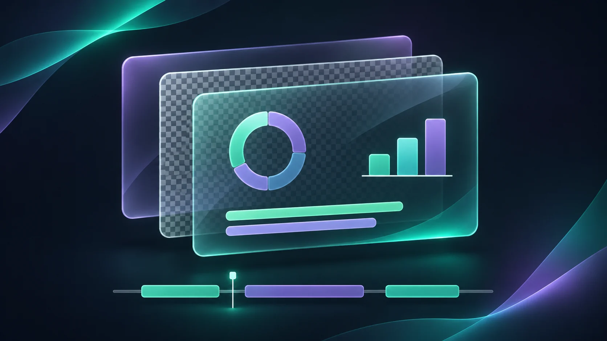

# Overlay Studio

**Free edition · Source available**

[简体中文](README.md) · [Project homepage](https://jeszhou.github.io/overlay-studio/en.html) · [Releases and downloads](https://github.com/jeszhou/overlay-studio/releases)



Turn timestamped subtitles into editable motion graphics. Adjust any of the 20 built-in cards in the local editor, then export a transparent MOV or WebM to layer over your footage in a video editor.

## Quick start

### Ask AI to install it

Open the full repository folder in an AI tool that can read files and run terminal commands. If you have yet to download the project, open the folder where you want to put it, then share this prompt.

```text
Install and launch the free edition of Overlay Studio on this computer. Prefer the source already in the current folder.
If the source is missing, get it from https://github.com/jeszhou/overlay-studio and place it in a new folder.
Check Node.js (22.12 or later), npm, FFmpeg, and ffprobe. Use official installation methods for missing tools.
In motion-playground, run npm ci using package-lock.json, then run npm run dev.
Verify that http://localhost:5177 opens and keep the server running. Tell me the install path, how to restart it, and how to open the demo and export a transparent MOV.
```

### Install manually

1. [Download the source ZIP](https://github.com/jeszhou/overlay-studio/releases/latest) and extract it, or run `git clone https://github.com/jeszhou/overlay-studio.git`.
2. Install [Node.js](https://nodejs.org/) 22.12 or later, plus FFmpeg and ffprobe. On Windows, run `winget install --id Gyan.FFmpeg -e` in PowerShell. On macOS with Homebrew, run `brew install ffmpeg`. Reopen the terminal afterward.
3. Open the source folder’s `motion-playground` directory. On Windows, double-click `start-overlay-studio.bat`, or run `npm.cmd ci` and `npm.cmd run dev` in PowerShell. On macOS, run `npm ci` and `npm run dev` in Terminal.
4. Keep the terminal running and open [localhost:5177](http://localhost:5177/). Select **示例** (Demo) in the top bar, play the sample, then choose **导出透明 MOV** (Export transparent MOV). Export requires FFmpeg. The first installation also downloads Chromium for rendering.

## Create overlays from your own subtitles

1. Export an `.srt` file with timestamps from your video editor.
2. Open the full Overlay Studio repository in your AI tool. Share your SRT and ask it to generate an overlay JSON with the bundled `overlay-fx-generator` Skill.
3. Import the JSON and your video into the editor. Adjust cards, save the project, and export one card or the full timeline.

The repository includes project-level Skill entry points for Codex, Claude Code, CodeBuddy, and WorkBuddy. [Editor guide (Chinese)](操作指南.md)

## Releases and maintenance

- [Changelog (Chinese)](CHANGELOG.md) · [Candidate release notes](https://jeszhou.github.io/overlay-studio/releases.en.html)
- [Compare editions (Chinese)](https://jeszhou.github.io/overlay-studio/versions.html) · [Get Pro](https://www.overlaystudio.cn/purchase/#checkout)
- To package a candidate, run `python3 scripts/package-release.py --ref HEAD --output ../overlay-free-release` from the repository root. Use the source ZIP for local installation and export. The dist ZIP serves as a static frontend preview. After editing build inputs, stage the intended source changes and run `npm run build:manifest` from `motion-playground`. Review and commit the manifest with the source changes.

## License and credits

Free to use. Resale is prohibited. You can use the videos you make commercially. See [LICENSE-EN](LICENSE-EN) for the full terms and the [sound effect credits](motion-playground/public/sfx-default/来源与授权.txt) for individual sound licenses.

Created by 一页枝鸥. The original idea was inspired by public work shared by 茂茂AI.
